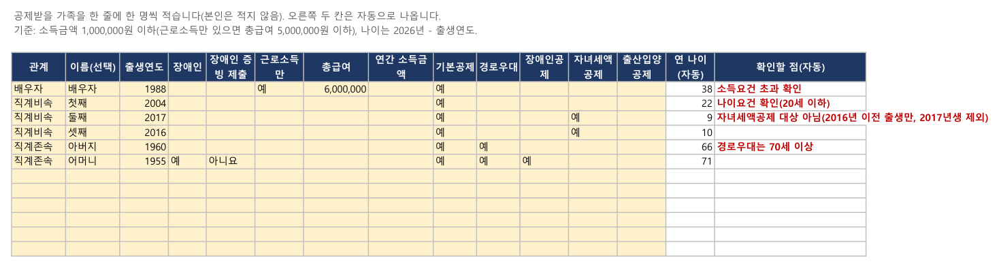
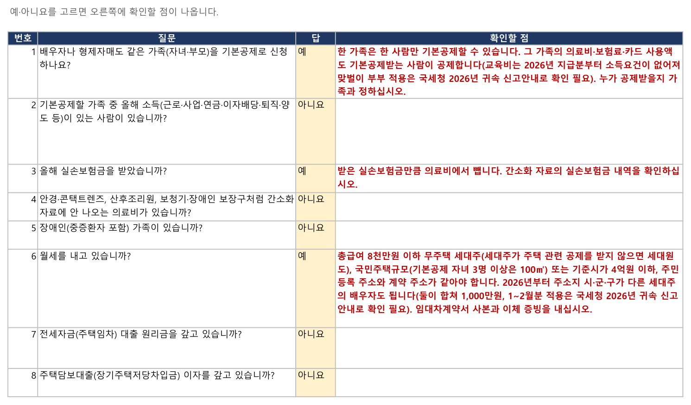

# 연말정산 사전 점검표 (2026년 귀속)

연말정산 서류를 회사에 내기 전에 **공제 요건을 스스로 확인하는 엑셀 점검표**입니다. 가족의 출생연도와 소득을 적고 질문에 예·아니요를 고르면, 기본공제 나이·소득 요건에 걸리는 가족, 같은 가족을 두 사람이 공제하는 실수, 따로 내야 하는 서류가 바로 표시됩니다.

- **2026년 귀속 전용, 2026-11 법령 기준**입니다. 국세청 2026년 귀속 연말정산 신고안내가 나오면 갱신판을 올립니다.
- 참고용 점검표입니다. **세액을 계산하지 않으며** 최종 판단은 회사 연말정산 담당자와 국세청 안내를 따릅니다.
- 입력 내용은 이 파일 안에만 있고 어디로도 보내지지 않습니다. 매크로 없이 수식과 목록 고르기만 씁니다.

## 👉 내려받기

[**연말정산_사전점검표_2026귀속_v2026.11.xlsx**](연말정산_사전점검표_2026귀속_v2026.11.xlsx)

엑셀(마이크로소프트 365)과 한셀(한컴오피스 2024)에서 열어 수식 결과를 확인했습니다. 내려받은 파일이 '보호된 보기'로 열리면 위쪽 [편집 사용]을 눌러야 목록과 자동 확인이 됩니다. 구글 스프레드시트·원드라이브 같은 인터넷 서비스에서 열면 입력 내용이 그 서비스에 저장됩니다.

## 쓰는 법

1. **1_부양가족**: 공제받을 가족을 한 줄에 한 명씩 적습니다. 나이는 출생연도로만 확인하므로 주민번호는 적지 않습니다. '기본공제'를 '예'로 고른 가족은 오른쪽 '확인할 점' 칸에 나이요건·소득요건·경로우대·자녀세액공제 확인 사항이 자동으로 나옵니다.
2. **2_질문**: 질문 20개에 예·아니요를 고르면 '예'인 질문 옆에 확인할 점이 나옵니다.
3. **3_제출서류**: 답에 따라 '제출 필요'가 표시된 서류를 간소화 자료와 함께 회사에 냅니다.
4. **4_올해 바뀐 점**: 2026년 귀속에 바뀐 공제와 올해로 끝나는 공제를 봅니다.

## 무엇을 확인하나요

| 구분 | 확인하는 것 |
|---|---|
| 기본공제 | 직계비속·입양자 20세 이하(2006.1.1 이후 출생), 직계존속 60세 이상(1966.12.31 이전 출생), 형제자매 20세 이하 또는 60세 이상, 장애인은 나이 제한 없음, 연간 소득금액 100만원 이하(근로소득만 있으면 총급여 500만원 이하) |
| 추가공제·세액공제 | 경로우대 70세 이상(1956.12.31 이전 출생), 2026년 귀속 자녀세액공제 2016년 이전 출생(나이 기준 9세 이상, 2017년생은 부칙으로 제외) |
| 가족끼리 겹치는 공제 | 배우자·형제자매가 같은 가족을 기본공제하는지, 기본공제받지 않는 쪽이 그 가족의 의료비·보험료·카드 사용액을 넣는지(교육비는 아래 '확인이 더 필요한 항목') |
| 특별공제 | 실손보험금 차감, 간소화에 없는 의료비·기부금 영수증, 부모 교육비, 가족 대학원 교육비, 형제자매 카드 사용액, 가족 명의 정치자금·고향사랑 기부금 |
| 주택자금 | 월세 세액공제, 전세자금 대출 원리금, 주택담보대출 이자, 주택청약종합저축의 요건과 서류 |
| 그 밖 | 중도 입사자의 전 직장 원천징수영수증, 혼인·출산 세액공제, 중소기업 취업자 감면, 투자 소득공제 서류 |

## 확인이 더 필요한 항목

아래는 법은 바뀌었지만 실무 적용을 국세청 2026년 귀속 신고안내로 확인해야 하는 항목입니다. 점검표에도 '확인 필요'로 표시해 두었습니다.

- 자녀세액공제: 2017년생 처리 실무
- 교육비 가족 소득요건 폐지(2026년 지급분부터): 맞벌이 부부의 배우자·자녀 교육비 적용 방식
- 월세 세액공제: 세대주의 배우자 추가공제와 다자녀 100㎡ 기준의 2026년 1~2월 지급분 적용

## 근거

소득세법·소득세법 시행령, 조세특례제한법·같은 법 시행령(국가법령정보센터 2026-11 현행 조문과 부칙), 국세청 국세상담센터 연말정산 자주 묻는 Q&A. 시트 '4_올해 바뀐 점'에 항목마다 조문을 적었습니다.

## 면책

개인이 만든 **비공식** 점검표로 국세청과 관계가 없습니다. 결과는 참고자료이며 정확성·완전성을 보증하지 않습니다. 세액 계산과 공제 여부의 최종 판단은 회사 연말정산 담당자와 국세청 안내를 따르십시오.

## 라이선스

[MIT License](LICENSE)
